# java项目课程在线教育资源管理系统java毕业设计

> 🎓 **计算机毕业设计 · java项目课程在线教育资源管理系统java毕业设计**
>
> 本仓库只放**项目介绍 + 运行截图**（截图是站点带水印的原图，存在仓库 `images/` 里）。
>
> 👉 **完整可运行源码 / 数据库脚本 / 部署文档：[点我获取](https://geekcode.top/archives/java%E9%A1%B9%E7%9B%AE%E8%AF%BE%E7%A8%8B%E5%9C%A8%E7%BA%BF%E6%95%99%E8%82%B2%E8%B5%84%E6%BA%90%E7%AE%A1%E7%90%86%E7%B3%BB%E7%BB%9Fjava%E6%AF%95%E4%B8%9A%E8%AE%BE%E8%AE%A1?utm_source=github)**
>
> 💬 咨询微信：**ir9372**　|　🌐 更多项目：[极客代码 geekcode.top](https://geekcode.top/?utm_source=github)
>
> 📌 项目详情页：<https://geekcode.top/archives/java%E9%A1%B9%E7%9B%AE%E8%AF%BE%E7%A8%8B%E5%9C%A8%E7%BA%BF%E6%95%99%E8%82%B2%E8%B5%84%E6%BA%90%E7%AE%A1%E7%90%86%E7%B3%BB%E7%BB%9Fjava%E6%AF%95%E4%B8%9A%E8%AE%BE%E8%AE%A1?utm_source=github>

<table><td width="230" align="center"> <b>扫码加微信 ir9372</b></td><td valign="middle">📦 源码 = 项目介绍 + 全部运行截图 + 数据库 + 部署文档 👉 点上方任意截图，直接跳到 <b>极客代码 geekcode.top</b> 详情页</td></table>

---

<h1>java项目_课程在线教育资源管理系统_java毕业设计</h1>
<h2>项目概述</h2>

本项目为「课程在线教育资源管理系统」，是一套面向在线教学场景的后端服务系统。系统以课程资源与在线考试为核心，围绕公告信息、课程信息、试卷与试题、考试记录、留言反馈等业务对象构建完整的教学资源管理能力。学生可通过前台完成课程浏览、试卷作答、查看考试记录与错题、提交留言反馈并维护个人中心；教师与管理员可对学生、教师、课程、公告、试卷、试题、考试记录、留言等数据进行统一维护。系统采用 Spring 体系（Spring MVC + Spring JDBC/事务 + AOP）作为基础框架，持久层使用 MyBatis-Plus，数据源由 Druid 连接池管理，以纯 API 形式对外提供 JSON 接口，前端页面独立部署并通过 HTTP 调用后端接口。适用人群为高校课程设计/毕业设计学习者，以及需要轻量级在线教学与考试管理能力的中小教学机构。

<h2>技术架构</h2>
<h3>总体架构</h3>

系统为纯后端 API 架构（pure-api），仓库内不含视图层与前端路由，所有业务能力以 HTTP 接口形式暴露，前端页面作为独立工程部署后通过接口与后端交互。

<a href="https://geekcode.top/archives/java%E9%A1%B9%E7%9B%AE%E8%AF%BE%E7%A8%8B%E5%9C%A8%E7%BA%BF%E6%95%99%E8%82%B2%E8%B5%84%E6%BA%90%E7%AE%A1%E7%90%86%E7%B3%BB%E7%BB%9Fjava%E6%AF%95%E4%B8%9A%E8%AE%BE%E8%AE%A1?utm_source=github" title="查看完整源码">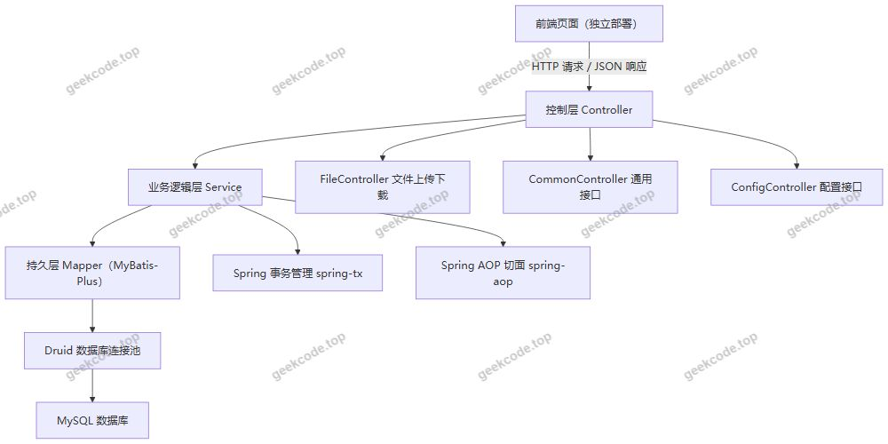</a>

<h3>分层说明</h3>
<ul>
<li><strong>控制层</strong>：由 12 个 Controller 组成，包括 <code>UserController</code>（账号与登录）、<code>XueshengController</code>（学生）、<code>JiaoshiController</code>（教师）、<code>KechengxinxiController</code>（课程信息）、<code>GonggaoxinxiController</code>（公告信息）、<code>ExampaperController</code>（试卷）、<code>ExamquestionController</code>（试题）、<code>ExamrecordController</code>（考试记录）、<code>MessagesController</code>（留言反馈）、<code>FileController</code>（文件）、<code>CommonController</code>（通用能力）、<code>ConfigController</code>（配置）。控制层负责请求接收、参数校验与结果封装。</li>
<li><strong>业务逻辑层</strong>：承载课程、试卷、试题、考试记录等业务规则，由 Spring 容器管理，并通过 <code>spring-tx</code> 提供声明式事务支持。</li>
<li><strong>持久层</strong>：使用 MyBatis-Plus 完成单表与条件查询、分页等数据访问操作，减少样板 SQL；实体与表结构通过注解或映射配置关联。</li>
<li><strong>数据源</strong>：使用 Druid 连接池，提供连接复用、监控与稳定性保障。</li>
<li><strong>切面能力</strong>：依赖 <code>spring-aop</code>，用于横切逻辑（如统一处理、日志等）的织入。</li>
<li><strong>测试</strong>：引入 JUnit 作为单元测试框架。</li>
</ul>
<h3>数据库设计要点</h3>

根据业务控制器与前台菜单，系统数据模型围绕以下核心实体组织：

<table>
<thead>
<tr>
<th>数据对象</th>
<th>对应业务控制器</th>
<th>设计要点</th>
</tr>
</thead>
<tbody><tr>
<td>用户账号</td>
<td><code>UserController</code></td>
<td>承载登录鉴权信息，区分账号身份</td>
</tr>
<tr>
<td>学生信息</td>
<td><code>XueshengController</code></td>
<td>学生档案数据，与考试记录关联</td>
</tr>
<tr>
<td>教师信息</td>
<td><code>JiaoshiController</code></td>
<td>教师档案数据，与课程信息关联</td>
</tr>
<tr>
<td>课程信息</td>
<td><code>KechengxinxiController</code></td>
<td>课程资源主体数据，供前台课程信息栏目展示</td>
</tr>
<tr>
<td>公告信息</td>
<td><code>GonggaoxinxiController</code></td>
<td>系统公告发布与展示</td>
</tr>
<tr>
<td>试卷</td>
<td><code>ExampaperController</code></td>
<td>试卷主体，作为试题的归属载体</td>
</tr>
<tr>
<td>试题</td>
<td><code>ExamquestionController</code></td>
<td>隶属于试卷的题目数据，支撑在线作答与错题回溯</td>
</tr>
<tr>
<td>考试记录</td>
<td><code>ExamrecordController</code></td>
<td>记录学生作答结果，是考试记录与错题本的数据来源</td>
</tr>
<tr>
<td>留言反馈</td>
<td><code>MessagesController</code></td>
<td>前台留言与后台回复的数据载体</td>
</tr>
<tr>
<td>文件资源</td>
<td><code>FileController</code></td>
<td>上传文件的存储与访问</td>
</tr>
</tbody></table>

实体字段的完整定义需以项目实际建表脚本与实体类为准，现有信息未提供字段级明细。

<h3>技术选型理由</h3>
<ul>
<li><strong>MyBatis-Plus</strong>：在 MyBatis 基础上提供通用 CRUD 与条件构造器，适配多实体、多条件筛选的管理类业务，减少重复 SQL 编写，同时保留手写 SQL 的灵活性。</li>
<li><strong>Druid</strong>：成熟的数据库连接池实现，具备连接监控与性能统计能力，便于开发期排查 SQL 与连接问题。</li>
<li><strong>Spring MVC</strong>：以注解方式声明 REST 接口，配合参数绑定与 JSON 序列化，天然适配前后端分离的纯 API 形态。</li>
<li><strong>spring-tx 声明式事务</strong>：保证考试记录写入、试卷与试题关联维护等复合操作的数据一致性。</li>
<li><strong>JUnit</strong>：为业务层与接口层提供可重复执行的测试支撑。</li>
</ul>
<h2>功能模块</h2>
<h3>前台用户端</h3>

前台导航菜单为「公告信息、课程信息、试卷列表、留言反馈」，个人中心菜单为「个人中心、考试记录、错题本」。

<a href="https://geekcode.top/archives/java%E9%A1%B9%E7%9B%AE%E8%AF%BE%E7%A8%8B%E5%9C%A8%E7%BA%BF%E6%95%99%E8%82%B2%E8%B5%84%E6%BA%90%E7%AE%A1%E7%90%86%E7%B3%BB%E7%BB%9Fjava%E6%AF%95%E4%B8%9A%E8%AE%BE%E8%AE%A1?utm_source=github" title="查看完整源码">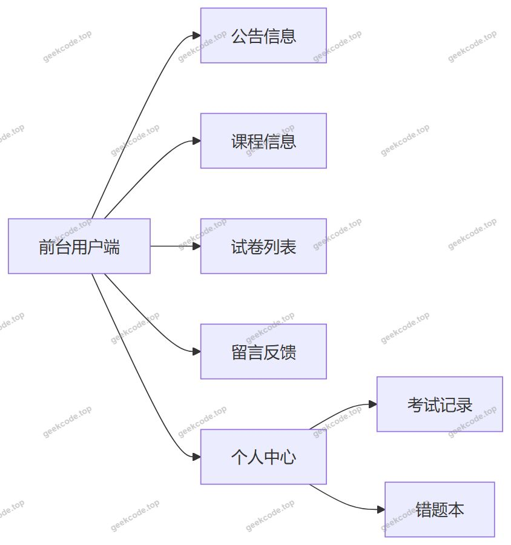</a>

<table>
<thead>
<tr>
<th>模块</th>
<th>功能描述</th>
</tr>
</thead>
<tbody><tr>
<td>公告信息</td>
<td>展示系统发布的公告内容，供学生了解教学通知与系统动态</td>
</tr>
<tr>
<td>课程信息</td>
<td>浏览课程资源信息，查看课程列表与课程详情</td>
</tr>
<tr>
<td>试卷列表</td>
<td>查看可作答的试卷清单，进入试卷进行在线答题</td>
</tr>
<tr>
<td>留言反馈</td>
<td>提交留言与反馈意见，查看留言处理情况</td>
</tr>
<tr>
<td>个人中心</td>
<td>维护个人资料与账号相关信息</td>
</tr>
<tr>
<td>考试记录</td>
<td>查询本人历次考试的作答记录与结果</td>
</tr>
<tr>
<td>错题本</td>
<td>依据考试记录与试题数据，汇总作答错误的题目供复习</td>
</tr>
</tbody></table>
<h3>后台管理端</h3>

后台管理能力由后端管理类接口提供，页面工程独立于本仓库。

<table>
<thead>
<tr>
<th>模块</th>
<th>对应控制器</th>
<th>功能描述</th>
</tr>
</thead>
<tbody><tr>
<td>账号与登录管理</td>
<td><code>UserController</code></td>
<td>处理登录、账号信息维护等用户相关业务</td>
</tr>
<tr>
<td>学生管理</td>
<td><code>XueshengController</code></td>
<td>学生信息的新增、修改、删除、查询</td>
</tr>
<tr>
<td>教师管理</td>
<td><code>JiaoshiController</code></td>
<td>教师信息的新增、修改、删除、查询</td>
</tr>
<tr>
<td>课程信息管理</td>
<td><code>KechengxinxiController</code></td>
<td>课程资源的维护与发布，支撑前台课程信息栏目</td>
</tr>
<tr>
<td>公告信息管理</td>
<td><code>GonggaoxinxiController</code></td>
<td>公告的发布、修改、删除与查询</td>
</tr>
<tr>
<td>试卷管理</td>
<td><code>ExampaperController</code></td>
<td>试卷的创建与维护，支撑前台试卷列表</td>
</tr>
<tr>
<td>试题管理</td>
<td><code>ExamquestionController</code></td>
<td>试题的录入与维护，与试卷建立归属关系</td>
</tr>
<tr>
<td>考试记录管理</td>
<td><code>ExamrecordController</code></td>
<td>考试记录的查询与统计，支撑成绩与错题数据</td>
</tr>
<tr>
<td>留言反馈管理</td>
<td><code>MessagesController</code></td>
<td>留言的查看与回复处理</td>
</tr>
<tr>
<td>文件管理</td>
<td><code>FileController</code></td>
<td>文件上传、下载等资源处理</td>
</tr>
<tr>
<td>通用接口</td>
<td><code>CommonController</code></td>
<td>提供跨模块的通用查询与辅助能力</td>
</tr>
<tr>
<td>配置管理</td>
<td><code>ConfigController</code></td>
<td>提供系统配置相关接口</td>
</tr>
</tbody></table>
<h2>用户角色与权限</h2>

系统依据账号体系与业务控制器划分出三类角色：管理员、教师、学生。

<a href="https://geekcode.top/archives/java%E9%A1%B9%E7%9B%AE%E8%AF%BE%E7%A8%8B%E5%9C%A8%E7%BA%BF%E6%95%99%E8%82%B2%E8%B5%84%E6%BA%90%E7%AE%A1%E7%90%86%E7%B3%BB%E7%BB%9Fjava%E6%AF%95%E4%B8%9A%E8%AE%BE%E8%AE%A1?utm_source=github" title="查看完整源码">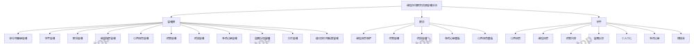</a>

<h3>管理员</h3>

拥有系统全部管理权限，可访问账号与登录管理、学生管理、教师管理、课程信息管理、公告信息管理、试卷管理、试题管理、考试记录管理、留言反馈管理、文件管理，以及通用接口与配置管理接口。

<h3>教师</h3>

面向教学资源的维护角色，可进行课程信息维护、试卷管理与试题管理，并查看考试记录以了解学生作答情况，同时可查看公告信息。教师档案本身由 <code>JiaoshiController</code> 提供管理能力。

<h3>学生</h3>

面向学习与考试的角色，可访问公告信息、课程信息、试卷列表、留言反馈四个前台栏目，并在个人中心中维护个人资料、查看考试记录、使用错题本进行复习。

<h2>项目特色与创新点</h2>
<ul>
<li><strong>教学资源与在线考试一体化</strong>：将公告、课程、试卷、试题、考试记录纳入同一系统管理，避免资源与考核数据分散在不同工具中，形成「资源发布—在线作答—结果记录—错题复习」的闭环。</li>
<li><strong>错题本驱动的复习机制</strong>：基于考试记录与试题数据聚合错题，将一次性考试结果转化为可复用的复习资源，提升学习闭环的完整性。</li>
<li><strong>纯 API 分层架构，前后端解耦</strong>：后端仅输出 JSON 接口，前端页面独立部署，接口可同时服务于 Web 页面与其他客户端，便于后续扩展与替换前端实现。</li>
<li><strong>MyBatis-Plus + Druid 的数据访问组合</strong>：通用 CRUD 与条件构造器降低多实体管理模块的开发成本，Druid 连接池提供连接监控能力，便于定位数据访问瓶颈。</li>
<li><strong>角色边界清晰</strong>：通过管理员、教师、学生三类角色与对应控制器划分职责，管理端与用户端能力分离，权限边界明确。</li>
</ul>
<h2>部署环境</h2>
<table>
<thead>
<tr>
<th>类别</th>
<th>要求</th>
</tr>
</thead>
<tbody><tr>
<td>运行环境</td>
<td>JDK（版本需与项目依赖的 Spring 版本匹配，现有信息未给出具体版本号）</td>
</tr>
<tr>
<td>构建工具</td>
<td>Maven（依据依赖坐标与项目结构）</td>
</tr>
<tr>
<td>数据库</td>
<td>MySQL，需提前创建数据库并导入建表与初始化数据脚本</td>
</tr>
<tr>
<td>连接池</td>
<td>Druid，通过项目配置文件配置数据源连接参数</td>
</tr>
<tr>
<td>持久层框架</td>
<td>MyBatis-Plus，需在配置文件中指定实体扫描与映射相关配置</td>
</tr>
<tr>
<td>Web 容器</td>
<td>支持 Spring MVC 的 Servlet 容器（内嵌容器或独立 Tomcat 均可，依据实际打包方式）</td>
</tr>
<tr>
<td>测试框架</td>
<td>JUnit，用于运行项目单元测试</td>
</tr>
<tr>
<td>前端页面</td>
<td>前端工程独立部署，需配置后端接口访问地址；本仓库不包含前端代码</td>
</tr>
</tbody></table>

启动前需完成数据库连接信息、文件上传路径等配置项的填写，确保后端服务启动后可正常响应前端页面的接口调用。

<h2>五、技术特性</h2>
<ul>
<li>使用 MyBatis-Plus 简化数据访问层开发</li>
</ul>
<h2>六、功能模块截图</h2>
<h3>后台管理端</h3>
<h4>页面-登录</h4>

<h4>页面-公告信息</h4>

<a href="https://geekcode.top/archives/java%E9%A1%B9%E7%9B%AE%E8%AF%BE%E7%A8%8B%E5%9C%A8%E7%BA%BF%E6%95%99%E8%82%B2%E8%B5%84%E6%BA%90%E7%AE%A1%E7%90%86%E7%B3%BB%E7%BB%9Fjava%E6%AF%95%E4%B8%9A%E8%AE%BE%E8%AE%A1?utm_source=github" title="查看完整源码">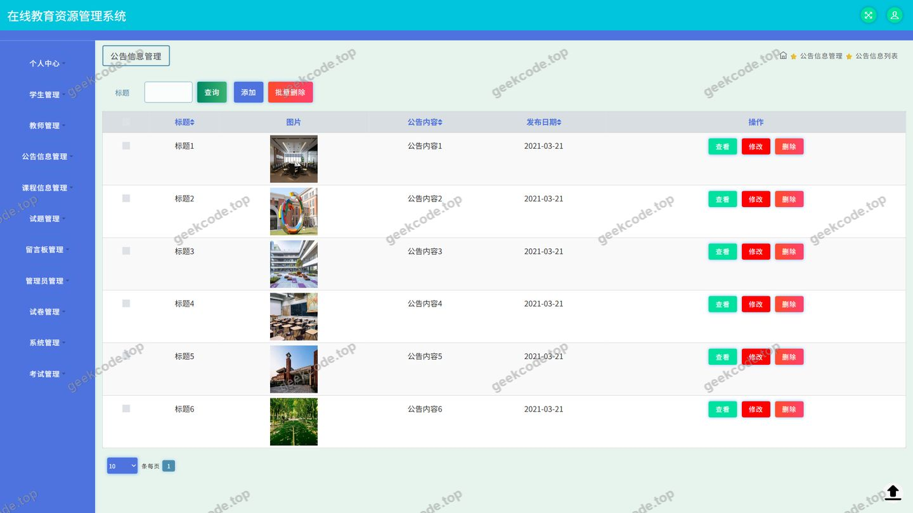</a>

<h4>页面-教师</h4>

<a href="https://geekcode.top/archives/java%E9%A1%B9%E7%9B%AE%E8%AF%BE%E7%A8%8B%E5%9C%A8%E7%BA%BF%E6%95%99%E8%82%B2%E8%B5%84%E6%BA%90%E7%AE%A1%E7%90%86%E7%B3%BB%E7%BB%9Fjava%E6%AF%95%E4%B8%9A%E8%AE%BE%E8%AE%A1?utm_source=github" title="查看完整源码">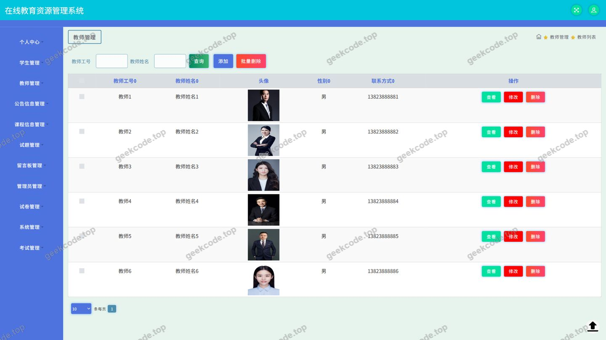</a>

<h4>页面-考试记录</h4>

<a href="https://geekcode.top/archives/java%E9%A1%B9%E7%9B%AE%E8%AF%BE%E7%A8%8B%E5%9C%A8%E7%BA%BF%E6%95%99%E8%82%B2%E8%B5%84%E6%BA%90%E7%AE%A1%E7%90%86%E7%B3%BB%E7%BB%9Fjava%E6%AF%95%E4%B8%9A%E8%AE%BE%E8%AE%A1?utm_source=github" title="查看完整源码">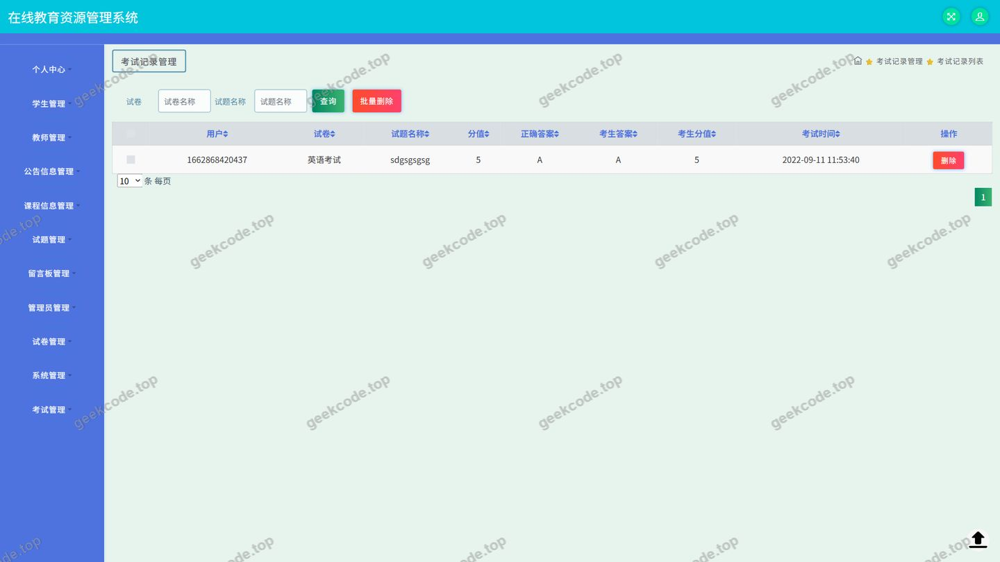</a>

<h4>页面-课程信息</h4>

<a href="https://geekcode.top/archives/java%E9%A1%B9%E7%9B%AE%E8%AF%BE%E7%A8%8B%E5%9C%A8%E7%BA%BF%E6%95%99%E8%82%B2%E8%B5%84%E6%BA%90%E7%AE%A1%E7%90%86%E7%B3%BB%E7%BB%9Fjava%E6%AF%95%E4%B8%9A%E8%AE%BE%E8%AE%A1?utm_source=github" title="查看完整源码">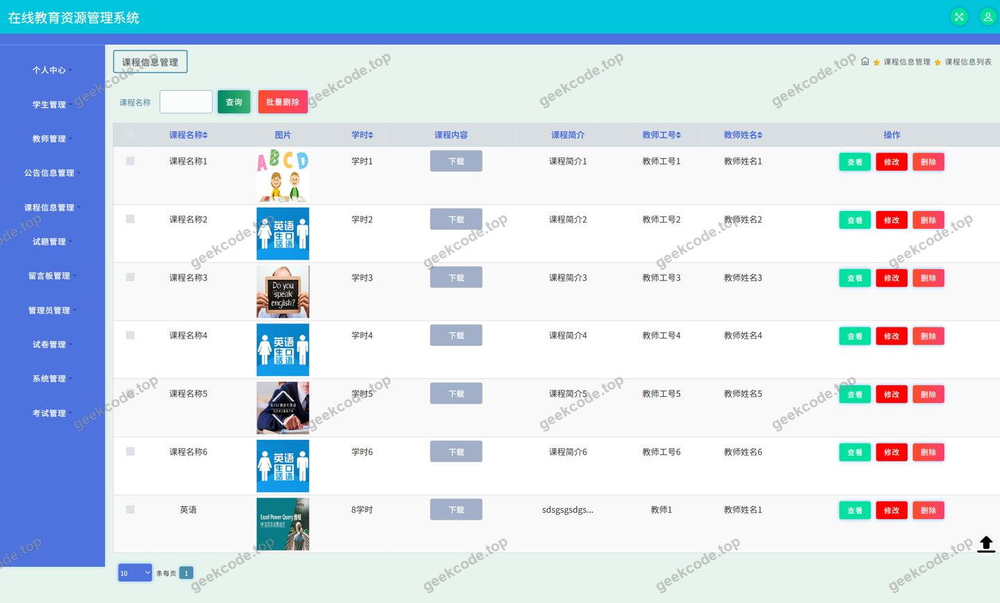</a>

<h4>页面-试卷</h4>

<a href="https://geekcode.top/archives/java%E9%A1%B9%E7%9B%AE%E8%AF%BE%E7%A8%8B%E5%9C%A8%E7%BA%BF%E6%95%99%E8%82%B2%E8%B5%84%E6%BA%90%E7%AE%A1%E7%90%86%E7%B3%BB%E7%BB%9Fjava%E6%AF%95%E4%B8%9A%E8%AE%BE%E8%AE%A1?utm_source=github" title="查看完整源码">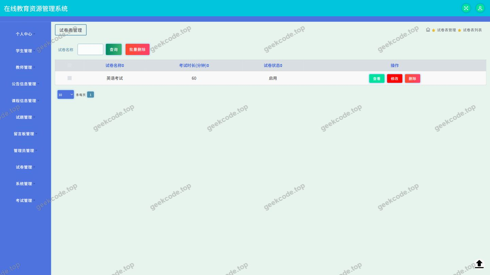</a>

<h4>页面-试题</h4>

<a href="https://geekcode.top/archives/java%E9%A1%B9%E7%9B%AE%E8%AF%BE%E7%A8%8B%E5%9C%A8%E7%BA%BF%E6%95%99%E8%82%B2%E8%B5%84%E6%BA%90%E7%AE%A1%E7%90%86%E7%B3%BB%E7%BB%9Fjava%E6%AF%95%E4%B8%9A%E8%AE%BE%E8%AE%A1?utm_source=github" title="查看完整源码">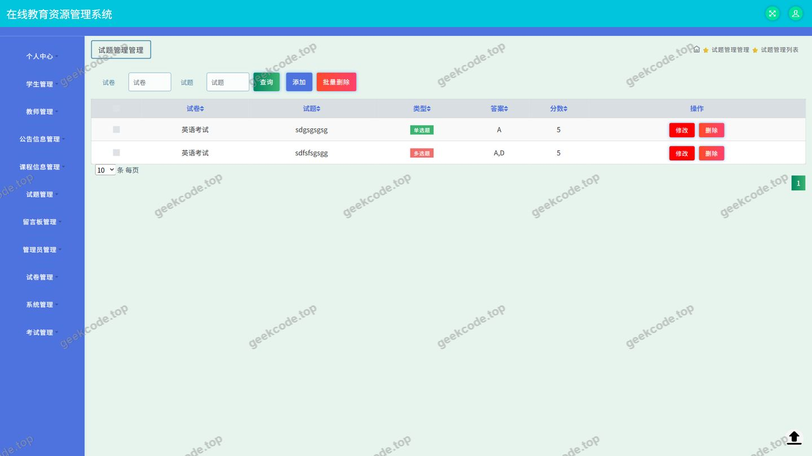</a>

<h4>页面-学生</h4>

<a href="https://geekcode.top/archives/java%E9%A1%B9%E7%9B%AE%E8%AF%BE%E7%A8%8B%E5%9C%A8%E7%BA%BF%E6%95%99%E8%82%B2%E8%B5%84%E6%BA%90%E7%AE%A1%E7%90%86%E7%B3%BB%E7%BB%9Fjava%E6%AF%95%E4%B8%9A%E8%AE%BE%E8%AE%A1?utm_source=github" title="查看完整源码">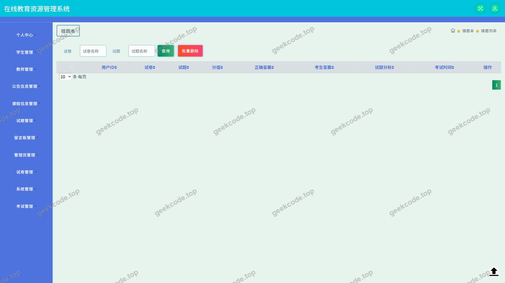</a>

<h4>页面-exampaperlist</h4>

<a href="https://geekcode.top/archives/java%E9%A1%B9%E7%9B%AE%E8%AF%BE%E7%A8%8B%E5%9C%A8%E7%BA%BF%E6%95%99%E8%82%B2%E8%B5%84%E6%BA%90%E7%AE%A1%E7%90%86%E7%B3%BB%E7%BB%9Fjava%E6%AF%95%E4%B8%9A%E8%AE%BE%E8%AE%A1?utm_source=github" title="查看完整源码">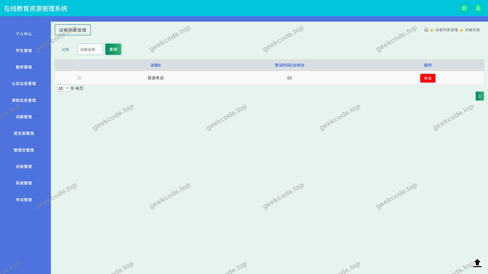</a>

---

## 获取完整源码

| 项目 | 说明 |
| --- | --- |
| 项目名 | java项目课程在线教育资源管理系统java毕业设计 |
| 运行截图 | 本文 12 张（站点带水印原图，仓库 `images/` 目录） |
| 完整源码 | [https://geekcode.top/archives/java%E9%A1%B9%E7%9B%AE%E8%AF%BE%E7%A8%8B%E5%9C%A8%E7%BA%BF%E6%95%99%E8%82%B2%E8%B5%84%E6%BA%90%E7%AE%A1%E7%90%86%E7%B3%BB%E7%BB%9Fjava%E6%AF%95%E4%B8%9A%E8%AE%BE%E8%AE%A1?utm_source=github](https://geekcode.top/archives/java%E9%A1%B9%E7%9B%AE%E8%AF%BE%E7%A8%8B%E5%9C%A8%E7%BA%BF%E6%95%99%E8%82%B2%E8%B5%84%E6%BA%90%E7%AE%A1%E7%90%86%E7%B3%BB%E7%BB%9Fjava%E6%AF%95%E4%B8%9A%E8%AE%BE%E8%AE%A1?utm_source=github) |
| 咨询微信 | **ir9372**（备注：jingpin-yuanma） |
| 更多项目 | [极客代码 geekcode.top](https://geekcode.top/?utm_source=github) |

> 需要源码、部署、改配置、跑不起来等问题，加微信 ir9372 沟通，说明项目名即可。
